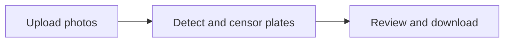

## censor-plate

A local, CPU-only web app that detects and censors license plates in photos. Upload up to **30 JPEG, PNG, or still WebP images** per batch, **20 MiB each**. The app is configured for European plate photos, including German plates.



## Quick start

### Windows

Use 64-bit Python 3.10–3.13. The commands below use Python 3.12.

```powershell
py -3.12 -m venv .venv
.\.venv\Scripts\python.exe -m pip install -r requirements.txt
.\.venv\Scripts\python.exe download_model.py
.\.venv\Scripts\python.exe main.py
```

If ONNX Runtime reports a missing DLL, install the [Microsoft Visual C++ x64 redistributable](https://learn.microsoft.com/en-us/cpp/windows/latest-supported-vc-redist).

### Ubuntu with Docker Compose

Use Docker Engine with Compose v2 on x86-64 or ARM64.

```bash
python3 download_model.py
docker compose up -d --build
```

Open [localhost:8000](http://localhost:8000) after starting the app. The first setup downloads the dependencies and verifies the model checksum. Photo processing works offline after setup.

## Censor a batch

1. Drop your photos into the browser and choose **blackout** (default), **blur**, or **mosaic**. Adjust detection confidence, coverage, and output size if needed.
2. Click **Censor photos** and inspect every result. Small, angled, or distant plates can be missed, and blur or mosaic can leave characters readable.
3. Download individual JPEGs or a batch ZIP. The ZIP includes `censored/`, `review_required/` for photos with no detected plate, and `manifest.json` with results and rejected files. Exported JPEGs have EXIF and GPS metadata removed.

## Deployment notes

- The Docker port binds to loopback. For a remote server, use `ssh -N -L 8000:127.0.0.1:8000 user@server`. For shared access, use an authenticated HTTPS reverse proxy with the original Host header, a body limit of at least 601 MiB, and timeouts that allow large batches to finish.
- Run one worker to keep the one-batch limit. Compose limits the app to 2 CPUs and 2 GiB of RAM. Allow at least 3 GiB for temporary files. Forced stops can leave photos in the `plate_tmp` volume. See [Compose settings](docker-compose.yml) and [runtime options](main.py).
- If the model fails to load, check `/health` and the server logs. Restart after installing or replacing the weights. See the [model provenance and license](models/NOTICE.md).

## Tests

```powershell
.\.venv\Scripts\python.exe -m pip install -r requirements-dev.txt
.\.venv\Scripts\python.exe -m pytest -q
```

[CI](.github/workflows/ci.yml) runs tests on Windows and Ubuntu and builds both Docker architectures.
